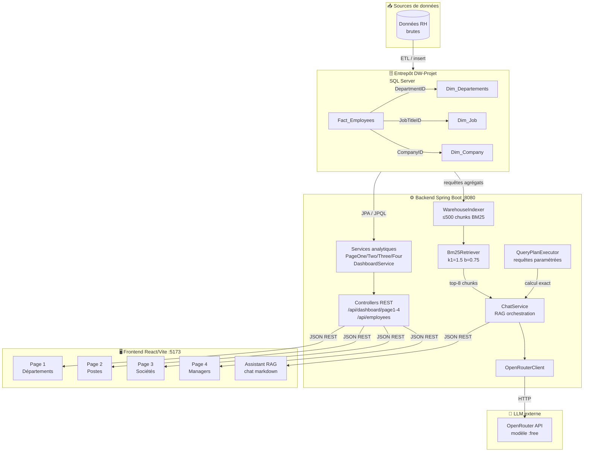
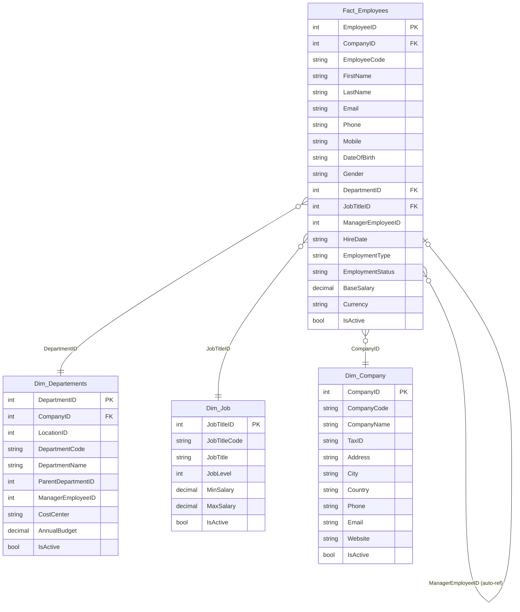
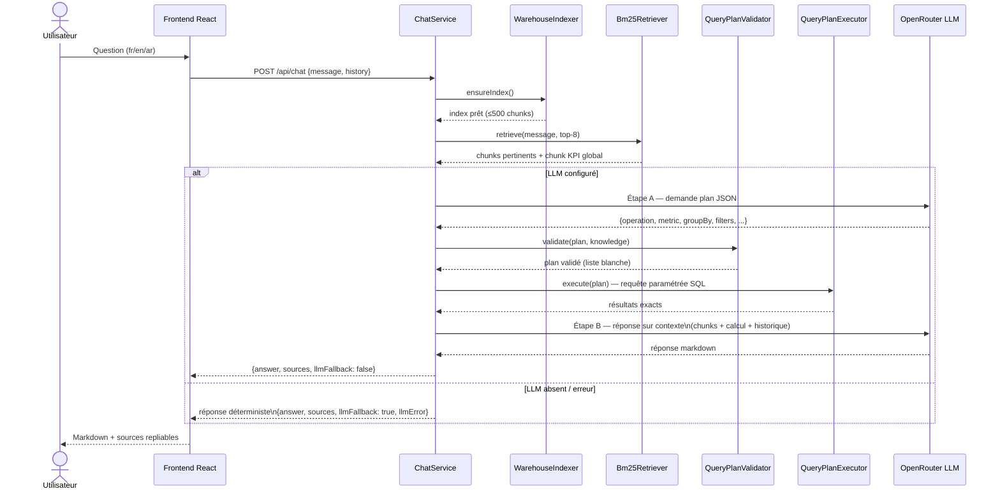
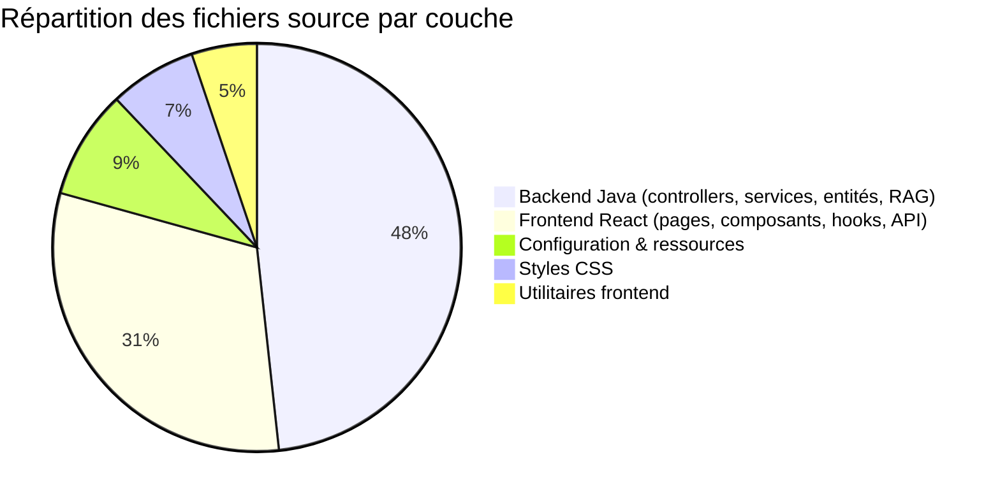
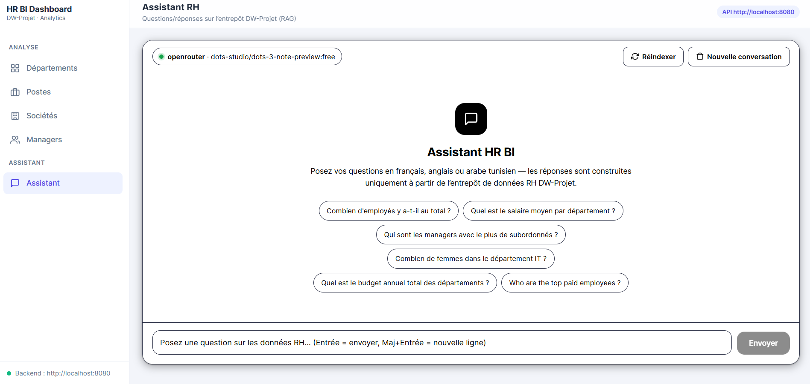
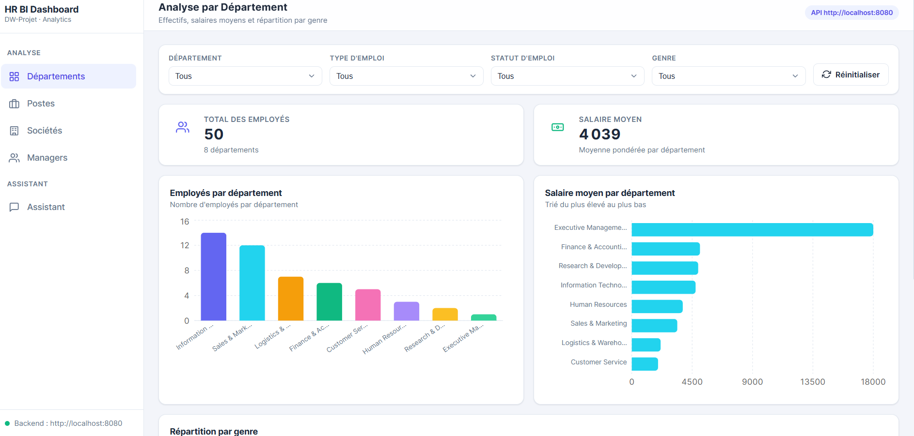
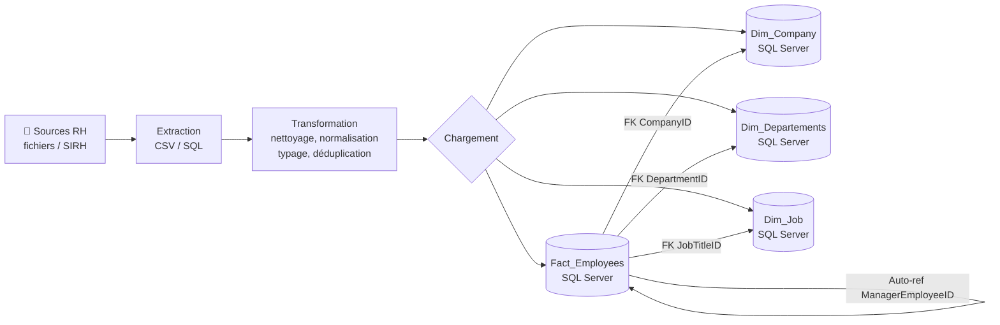

<div align="center">

# 🏢 HR BI Dashboard & Assistant RAG

### Tableau de bord analytique RH avec entrepôt de données et assistant IA hybride

[](https://openjdk.org/projects/jdk/21/)
[](https://spring.io/projects/spring-boot)
[](https://react.dev/)
[](https://vitejs.dev/)
[](https://www.microsoft.com/sql-server)
[](https://openrouter.ai/)
[](LICENSE)

---

[📌 À propos](#-à-propos) · [✨ Fonctionnalités](#-fonctionnalités) · [🏗️ Architecture](#️-architecture) · [🗄️ Data Warehouse](#️-data-warehouse) · [🤖 Assistant RAG](#-assistant-rag) · [🛠️ Stack](#️-stack-technique) · [🚀 Installation](#-installation) · [▶️ Utilisation](#️-utilisation) · [📸 Captures](#-captures-décran) · [📂 Structure](#-structure-du-projet) · [🔐 Variables d'env](#-variables-denvironnement) · [🗺️ Roadmap](#️-roadmap) · [👤 Auteur](#-auteur) · [📄 Licence](#-licence)

</div>

---

## 📌 À propos

**HR BI Dashboard** est une application full-stack de Business Intelligence dédiée aux données RH. Elle combine :

- Un **entrepôt de données** SQL Server en schéma étoile (`DW-Projet`) modélisant les employés, départements, postes et sociétés.
- Un **backend Spring Boot** exposant une API REST analytique avec agrégats, filtres dynamiques et jointures.
- Un **frontend React/Vite** à quatre tableaux de bord interactifs (graphiques Recharts, filtres temps-réel, KPI cards).
- Un **assistant RAG hybride** : récupération BM25 sur l'index en mémoire de l'entrepôt + plan de requête JSON validé + réponse LLM via OpenRouter — avec fallback déterministe si le LLM est indisponible.

---

## ✨ Fonctionnalités

- **4 tableaux de bord analytiques** couvrant les dimensions Département, Poste, Société et Hiérarchie
- **Filtres dynamiques** (département, poste, société, manager, genre, type et statut d'emploi)
- **KPI cards** calculés côté front à partir des agrégats backend (effectifs, salaires, masse salariale)
- **Graphiques interactifs** : barres verticales/horizontales, camembert, graphique composé barres+courbe, stacked bar
- **Assistant IA en langage naturel** (français, anglais, arabe tunisien translittéré)
  - Récupération BM25 top-8 + chunk KPI global toujours inclus
  - Plan de requête JSON produit par le LLM, validé sur liste blanche, exécuté en lecture seule
  - Historique de conversation (10 messages), persistance localStorage
  - Sources repliables (chunks + calcul exact)
  - Fallback déterministe si la clé LLM est absente ou si le modèle échoue
  - Rate-limiting 6 req/10 s par IP
- **Mode mock** : fonctionne sans backend via `VITE_USE_MOCK=true`
- **Sécurité** : requêtes paramétrées uniquement, détection des tentatives de prompt injection

---

## 🏗️ Architecture



---

## 🗄️ Data Warehouse

### Schéma en étoile



### Tables et rôles

| Table | Type | Description |
|---|---|---|
| `Fact_Employees` | Fait | Employés avec leurs attributs RH, salaires et références aux dimensions |
| `Dim_Departements` | Dimension | Départements avec hiérarchie, budget annuel, rattachement société |
| `Dim_Job` | Dimension | Titres de poste avec niveaux et fourchettes salariales |
| `Dim_Company` | Dimension | Sociétés avec localisation et contact |

---

## 🤖 Assistant RAG

L'assistant est un pipeline RAG hybride pur Java, sans base vectorielle externe ni embedding payant.

### Pipeline de traitement



### Mécanismes clés

| Composant | Rôle |
|---|---|
| `WarehouseIndexer` | Construit l'index BM25 au démarrage (max 500 chunks) : dimensions, agrégats par département/poste/société/manager, chunk KPI global, cartes employés (max 400). Emails et données de contact exclus. |
| `Bm25Retriever` | BM25 pur Java (k1=1,5 ; b=0,75). Aucun embedding, aucun service externe. Rebuildable à chaud via `POST /api/chat/reindex`. |
| `QueryPlanExecutor` | Reçoit un plan JSON (`operation`, `metric`, `groupBy`, `filters`) validé sur liste blanche et exécute une requête paramétrée en lecture seule sur SQL Server. Jamais de SQL libre. |
| `QueryPlanValidator` | Vérifie que toutes les valeurs du plan (IDs, noms de dimensions, enum genre/type/statut) existent dans `WarehouseKnowledge` avant exécution. |
| `ChatSecurity` | Sanitize les messages (caractères de contrôle), détecte les tentatives de prompt injection (system prompt, clés API, ignore instructions…). |
| `ChatRateLimitInterceptor` | Rate-limiting par IP : 6 requêtes / 10 secondes, HTTP 429 au-delà. |
| Fallback déterministe | Si le LLM est absent ou échoue, une réponse tabulaire est construite directement à partir des chunks BM25 et du résultat de calcul exact. `llmFallback: true` est retourné au frontend. |

---

## 🛠️ Stack technique

| Couche | Technologie | Version |
|---|---|---|
| **Frontend** | React | 18.3 |
| **Frontend** | Vite | 5.4 |
| **Frontend** | React Router | 6.30 |
| **Frontend** | Recharts | 2.15 |
| **Frontend** | React Markdown + remark-gfm | 9.1 / 4.0 |
| **Backend** | Spring Boot | 4.0.1 |
| **Backend** | Spring Data JPA | (inclus) |
| **Backend** | Java | 21 |
| **Backend** | Lombok | 1.18.30 |
| **Base de données** | Microsoft SQL Server | 2019+ |
| **Driver JDBC** | mssql-jdbc | 12.2.0 |
| **LLM (optionnel)** | OpenRouter (modèles `:free`) | API v1 |
| **Build frontend** | npm / Node.js | ≥ 18 |
| **Build backend** | Maven Wrapper | 3.x |

### Répartition des modules



---

## 🚀 Installation

### Prérequis

- **Java 21** (JDK)
- **Maven** (ou utiliser `./mvnw` fourni)
- **Node.js ≥ 18** et **npm**
- **Microsoft SQL Server** (2019+ ou SQL Server Express) avec la base `DW-Projet`

### 1. Cloner le dépôt

```bash
git clone https://github.com/enaceur-ahmed/Data-Warehouse-et-assistant-RAG.git
cd Data-Warehouse-et-assistant-RAG
```

### 2. Configurer la base de données

Assurez-vous que SQL Server est démarré et que la base `DW-Projet` existe avec les tables `Fact_Employees`, `Dim_Departements`, `Dim_Job` et `Dim_Company`.

### 3. Configurer le backend

```bash
cd demo
```

Copiez le fichier exemple et renseignez vos valeurs :

```bash
cp src/main/resources/application-local.example.properties \
   src/main/resources/application-local.properties
```

Éditez `application-local.properties` :

```properties
# Clé OpenRouter (optionnelle — sans elle, le fallback déterministe s'active)
openrouter.api-key=votre_cle_openrouter_ici
# Modèle à utiliser (laisser vide pour autodétection)
openrouter.model=
```

Définissez les variables d'environnement (ou renseignez directement dans `application.properties` en local) :

```bash
# Windows PowerShell
$env:DB_USERNAME = "sa"
$env:DB_PASSWORD = "votre_mot_de_passe_sql"

# Linux / macOS
export DB_USERNAME=sa
export DB_PASSWORD=votre_mot_de_passe_sql
```

### 4. Lancer le backend

```bash
# Depuis le dossier demo/
./mvnw spring-boot:run     # Linux/macOS
mvnw.cmd spring-boot:run   # Windows
```

Le serveur démarre sur **http://localhost:8080**.

> L'indexation RAG se lance automatiquement au démarrage. Les logs indiquent le nombre de chunks indexés.

### 5. Configurer et lancer le frontend

```bash
cd ../appDash
cp .env.example .env
# Éditez .env si besoin (VITE_API_BASE_URL pointe déjà sur http://localhost:8080)
npm install
npm run dev
```

L'application est disponible sur **http://localhost:5173**.

> **Mode sans backend** : mettez `VITE_USE_MOCK=true` dans `.env` pour utiliser des données fictives.

---

## ▶️ Utilisation

### Tableaux de bord

Naviguez via la barre latérale gauche :

| Page | Route | Description |
|---|---|---|
| Départements | `/page1` | Effectifs, salaire moyen et répartition par genre par département |
| Postes | `/page2` | Employés par titre de poste, salaires min/max/moyen, type de contrat |
| Sociétés | `/page3` | Masse salariale, effectifs et salaire moyen par société — tableau trié |
| Managers | `/page4` | Taille des équipes, salaire moyen des équipes, liste des managers |
| Assistant | `/assistant` | Chat RAG en langage naturel sur l'entrepôt |

Chaque page dispose d'une **barre de filtres** dynamique. Les filtres s'appliquent immédiatement (debounce) et peuvent être réinitialisés en un clic.

### Assistant RH

Exemples de questions :

```
Combien d'employés y a-t-il au total ?
Quel est le salaire moyen par département ?
Qui sont les managers avec le plus de subordonnés ?
Combien de femmes dans le département IT ?
Who are the top paid employees?
```

Le bouton **Réindexer** reconstruit l'index BM25 à partir de l'état courant de la base (utile après un import de données).

---

## 📸 Captures d'écran

<p align="center">
  
  <br/>
  <em>Assistant RAG hybride — Réponse markdown avec sources repliables</em>
</p>

<p align="center">
  
  <br/>
  <em>Tableau de bord analytique — Vue Départements (effectifs, salaires, répartition par genre)</em>
</p>

---

## 📂 Structure du projet

```
Data-Warehouse-et-assistant-RAG/
├── image1.png                          # Capture dashboard
├── image2.png                          # Capture assistant
├── .gitignore                          # Ignore racine (node_modules, .env, secrets)
│
├── appDash/                            # Frontend React / Vite
│   ├── src/
│   │   ├── api/
│   │   │   ├── client.js               # Couche HTTP (apiFetch / apiPost)
│   │   │   ├── dashboard.js            # Endpoints dashboard + normalisation
│   │   │   ├── chat.js                 # Endpoints assistant + localStorage
│   │   │   └── mock.js                 # Données fictives (VITE_USE_MOCK)
│   │   ├── components/
│   │   │   ├── Layout.jsx              # Shell (sidebar + topbar)
│   │   │   ├── KpiCard.jsx             # Carte KPI
│   │   │   ├── ChartCard.jsx           # Wrapper graphique
│   │   │   ├── DataTable.jsx           # Tableau trié + recherche
│   │   │   ├── FilterBar.jsx           # Barre de filtres
│   │   │   ├── chartUtils.jsx          # Tooltips, palettes, ticks tronqués
│   │   │   └── icons.jsx               # Icônes SVG inline
│   │   ├── hooks/
│   │   │   ├── useDashboardData.js     # Fetch + état (loading/error/data)
│   │   │   └── useReferenceData.js     # Chargement des listes de référence
│   │   ├── pages/
│   │   │   ├── PageOne.jsx             # Analyse par département
│   │   │   ├── PageTwo.jsx             # Analyse par poste
│   │   │   ├── PageThree.jsx           # Analyse par société
│   │   │   ├── PageFour.jsx            # Hiérarchie / managers
│   │   │   └── Assistant.jsx           # Chat RAG
│   │   ├── styles/                     # CSS modulaire (variables, base, layout, composants)
│   │   ├── utils/
│   │   │   ├── format.js               # Formatage nombres et salaires
│   │   │   └── derive.js               # Agrégats côté front (sumBy, weightedAverage…)
│   │   ├── App.jsx                     # Routage React Router
│   │   └── main.jsx                    # Point d'entrée React
│   ├── .env.example                    # Variables d'environnement (template)
│   └── package.json
│
└── demo/                               # Backend Spring Boot
    └── src/main/java/com/example/BI/
        ├── BiProjectApplication.java
        ├── Entity/                     # Entités JPA (Fact_Employees, Dim_*)
        ├── Repository/                 # Repositories Spring Data
        ├── Service/                    # Services analytiques (PageOne–Four, Dashboard)
        ├── Controller/                 # Controllers REST (/api/dashboard/*)
        ├── dto/                        # DTOs de réponse
        ├── Config/                     # Configuration Spring (CORS, WebMVC…)
        └── Chat/
            ├── ChatController.java     # POST /api/chat, GET /status, POST /reindex
            ├── ChatService.java        # Orchestration RAG hybride
            ├── ChatSecurity.java       # Sanitisation + détection prompt injection
            ├── ChatRateLimitInterceptor.java  # Rate-limit 6 req/10 s par IP
            ├── dto/                    # ChatRequest, ChatResponse, QueryPlan…
            ├── indexing/               # WarehouseIndexer + WarehouseKnowledge
            ├── llm/                    # OpenRouterClient + ModelDiscoveryService
            ├── planning/               # QueryPlanExecutor + QueryPlanValidator
            └── retrieval/              # Bm25Retriever + Chunk + TextNormalizer
```

---

## 🔐 Variables d'environnement

### Frontend (`appDash/.env`)

| Variable | Défaut | Description |
|---|---|---|
| `VITE_API_BASE_URL` | `http://localhost:8080` | URL de base du backend Spring Boot |
| `VITE_USE_MOCK` | `false` | `true` pour utiliser des données fictives sans backend |

### Backend (`demo/src/main/resources/`)

Ces valeurs sont à fournir via des **variables d'environnement** ou via `application-local.properties` (jamais commité) :

| Variable / Propriété | Description |
|---|---|
| `DB_USERNAME` | Nom d'utilisateur SQL Server (ex. `sa`) |
| `DB_PASSWORD` | Mot de passe SQL Server |
| `OPENROUTER_API_KEY` ou `openrouter.api-key` | Clé API OpenRouter (optionnelle — le fallback déterministe fonctionne sans elle) |
| `OPENROUTER_MODEL` ou `openrouter.model` | ID du modèle LLM (ex. `dots-studio/dots-3-note-preview:free`). Vide = autodétection du premier modèle `:free` disponible. |

> **Obtenir une clé OpenRouter gratuite** : [https://openrouter.ai/keys](https://openrouter.ai/keys). Les modèles suffixés `:free` sont sans coût mais peuvent être limités en débit.

---

## 🗄️ Pipeline ETL



> Le pipeline ETL n'est pas versionné dans ce dépôt. Les tables sont supposées déjà peuplées dans la base `DW-Projet`.

---

## 📡 Endpoints API

### Dashboard

| Méthode | Endpoint | Paramètres optionnels | Description |
|---|---|---|---|
| `GET` | `/api/dashboard/page1` | `departmentId`, `employmentType`, `employmentStatus`, `gender` | Agrégats par département (effectifs, salaires, genre) |
| `GET` | `/api/dashboard/page2` | `jobTitleId`, `employmentType`, `gender` | Agrégats par poste (effectifs, salaires, types de contrat) |
| `GET` | `/api/dashboard/page3` | `companyId`, `departmentId`, `jobTitleId` | Agrégats par société (effectifs, masse salariale) |
| `GET` | `/api/dashboard/page4` | `managerId`, `departmentId`, `jobTitleId` | Hiérarchie managers (équipes, salaires) |
| `GET` | `/api/dashboard/companies` | — | Liste des sociétés (référentiel) |
| `GET` | `/api/dashboard/departements` | — | Liste des départements (référentiel) |
| `GET` | `/api/dashboard/jobs` | — | Liste des postes (référentiel) |
| `GET` | `/api/dashboard/employees` | — | Liste des employés (référentiel) |

### Employés (jointures)

| Méthode | Endpoint | Description |
|---|---|---|
| `GET` | `/api/employees/with-company` | Employés avec informations de société |
| `GET` | `/api/employees/with-department` | Employés avec informations de département |
| `GET` | `/api/employees/with-job` | Employés avec informations de poste |

### Assistant RAG

| Méthode | Endpoint | Corps / Réponse | Description |
|---|---|---|---|
| `POST` | `/api/chat` | `{message, history[]}` → `{answer, sources[], llmFallback, llmError}` | Question → réponse RAG |
| `GET` | `/api/chat/status` | → `{provider, model, keyConfigured}` | État du fournisseur LLM |
| `POST` | `/api/chat/reindex` | → `{success, message}` | Reconstruction de l'index BM25 |

---

## 🗺️ Roadmap

- [ ] Authentification JWT (Spring Security)
- [ ] Export CSV/Excel des données des tableaux
- [ ] Pipeline ETL versionné (scripts SQL ou Apache Spark)
- [ ] Support de plusieurs entrepôts (multi-tenant)
- [ ] Streaming des réponses LLM (Server-Sent Events)
- [ ] Tests unitaires et d'intégration (JUnit 5 + Vitest)
- [ ] Containerisation Docker (docker-compose backend + frontend)
- [ ] Déploiement CI/CD GitHub Actions

---

## 👤 Auteur

**Naceur Ahmed**

- GitHub : [@enaceur-ahmed](https://github.com/enaceur-ahmed)

---

## 📄 Licence

Ce projet est distribué sous licence **MIT**. Voir le fichier [LICENSE](LICENSE) pour les détails.

---

<div align="center">

Fait avec ☕ et beaucoup de requêtes SQL

</div>
